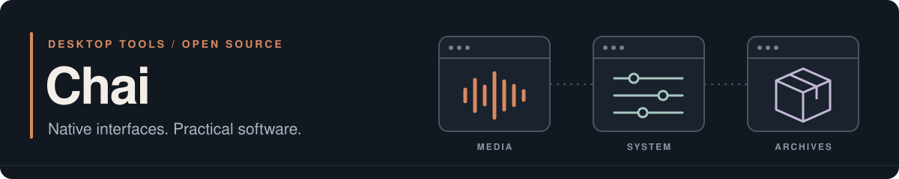

  

I build open-source desktop tools and private business software, from the first working version through changing requirements and major rebuilds.

My public projects focus on media, Mac maintenance, and archives, with native interfaces, local processing, and clear controls over what changes on disk.

## Selected projects

| Project | Overview & starting point |
| :--- | :--- |
| **[Eucrante](https://github.com/chai-in/Eucrante)** macOS · Swift | Save media locally, prepare Apple-native audio and video, and import into Music. **In development** · [Build from source](https://github.com/chai-in/Eucrante#build) · [Website](https://chai-in.github.io/Eucrante/) |
| **[7-Zip Hatch](https://github.com/chai-in/7zip-hatch)** Windows / macOS / Linux C++ · Rust | Browse, create, and extract standard archives. An independent 7-Zip and HatchZip fork with optional space-saving extraction. **Desktop preview** · [Downloads](https://github.com/chai-in/7zip-hatch#download) · [Extraction limits](https://github.com/chai-in/7zip-hatch#before-using-space-saving-extraction) |
| **[Mac Tidy](https://github.com/chai-in/Mac-Tidy)** Apple silicon macOS Swift | Inspect storage, preview cleanup, uninstall apps, and monitor system health. A native interface powered by the Mole engine. **In development** · [Build from source](https://github.com/chai-in/Mac-Tidy#build) · [Safety](https://github.com/chai-in/Mac-Tidy#safety) |

## Private work at Tibcon

I built Tibcon's CRM, shared authentication, and internal tools from scratch, taking the work through multiple scope changes and complete rebuilds of major components. My work spans product workflows, interfaces, backend services, data migrations, and deployment.

CRM and shared authentication are current private projects. Earlier Sentry and Portfolio projects are now retired. [Read how this work evolved](projects/tibcon.md).

## Working with the projects

Bug reports, reproducible examples, and focused improvements are welcome. Each repository has its own setup instructions, license, and contribution guidance:

[Eucrante](https://github.com/chai-in/Eucrante/blob/main/CONTRIBUTING.md) · [7-Zip Hatch](https://github.com/chai-in/7zip-hatch/blob/main/CONTRIBUTING.md) · [Mac Tidy](https://github.com/chai-in/Mac-Tidy/blob/main/CONTRIBUTING.md)

## Upstream work

[SamRewritten: Linux AppImage installation guidance](https://github.com/PaulCombal/SamRewritten/pull/96) — a proposed documentation improvement covering platform requirements and accurate installation commands. See the pull request for its current review status.

Earlier experiments

[Minecraft Bedrock Fogless](https://github.com/chai-in/Minecraft-Bedrock-Fogless) is an archived resource-pack experiment. It is no longer maintained.

